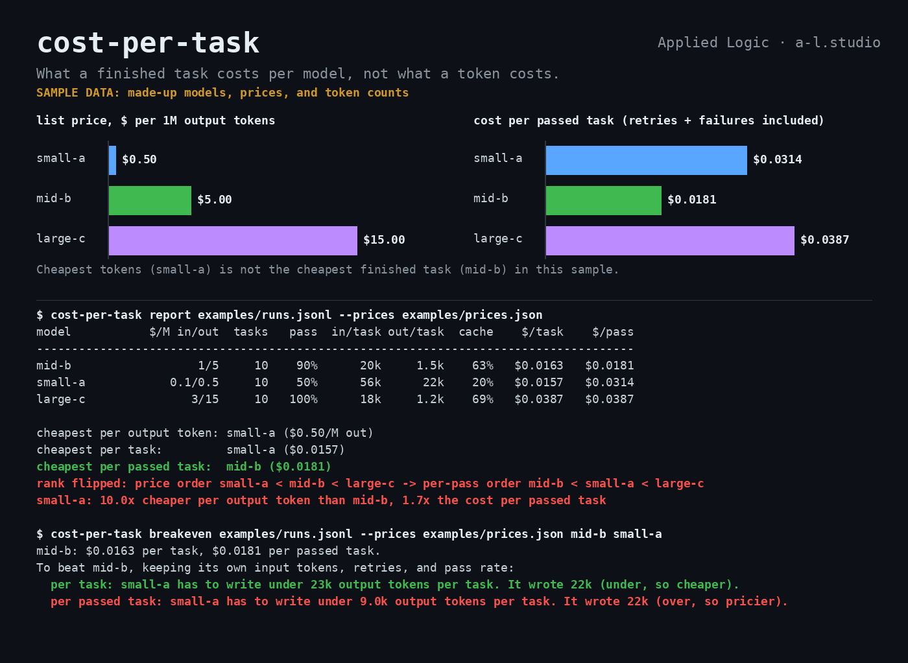

# cost-per-task

What a finished task costs per model, not what a token costs.

Price sheets compare models per million tokens. Your bill is per task: how many tokens the model spent on the job, how much of its input came back from cache, how many retries it took, and how often the answer was wrong anyway. A model with a tenth of the token price can still cost more per finished task if it writes ten times as much, misses the cache, and fails half the time.

cost-per-task reads the usage your runs already log, prices it with a table you control, and gives you per model:

- **$/task**: every call made for a task, retries included, at list price.
- **$/pass**: total spend divided by tasks that passed. Failed tasks still cost money, so they get charged to the ones that worked. This is the number to compare.
- **tokens per task**: input (with cache share) and output, reasoning included.
- **rank flip**: whether the cheapest model per token is still the cheapest per passed task.

It also has `breakeven` (how many output tokens per task a cheaper-per-token model can write before it stops being cheaper), `check` (exit 1 if cost per passed task is over a budget, for CI), and `ingest` (turns Claude Code and Codex session files into run records).

Usage is normalized across formats, because each provider counts cache differently: OpenAI Chat (`prompt_tokens` includes cached), OpenAI Responses and Codex (`input_tokens` includes cached), and Anthropic Messages (`input_tokens` excludes cache reads and writes, which are billed at their own rates).

Python 3.9+, stdlib only. No API keys, no network. It doesn't call any model. It does arithmetic on logs you already have.



## Quickstart

```bash
git clone https://github.com/jakehb1/cost-per-task && cd cost-per-task && python3 demo.py
```

The demo runs on **sample data**: three made-up models (`small-a`, `mid-b`, `large-c`), made-up prices, and token counts from a seeded generator (`examples/make_sample.py`). It's shaped to show a pattern, not measured from anything. Each model logs usage in a different provider format on purpose.

## Demo output

```
SAMPLE DATA: made-up models, prices, and token counts

$ cost-per-task report examples/runs.jsonl --prices examples/prices.json
model           $/M in/out  tasks   pass  in/task out/task  cache    $/task    $/pass
-------------------------------------------------------------------------------------
mid-b                  1/5     10    90%      20k     1.5k    63%   $0.0163   $0.0181
small-a            0.1/0.5     10    50%      56k      22k    20%   $0.0157   $0.0314
large-c               3/15     10   100%      18k     1.2k    69%   $0.0387   $0.0387

cheapest per output token: small-a ($0.50/M out)
cheapest per task:         small-a ($0.0157)
cheapest per passed task:  mid-b ($0.0181)
rank flipped: price order small-a < mid-b < large-c -> per-pass order mid-b < small-a < large-c
small-a: 10.0x cheaper per output token than mid-b, 1.7x the cost per passed task
(exit code 0)

$ cost-per-task breakeven examples/runs.jsonl --prices examples/prices.json mid-b small-a
mid-b: $0.0163 per task, $0.0181 per passed task.
To beat mid-b, keeping its own input tokens, retries, and pass rate:
  per task: small-a has to write under 23k output tokens per task. It wrote 22k (under, so cheaper).
  per passed task: small-a has to write under 9.0k output tokens per task. It wrote 22k (over, so pricier).
(exit code 0)

$ cost-per-task check examples/runs.jsonl --prices examples/prices.json --budget 0.025
OK    mid-b          $0.0181 per passed task, 90% pass rate (budget $0.0250)
OVER  small-a        $0.0314 per passed task, 50% pass rate (budget $0.0250)
OVER  large-c        $0.0387 per passed task, 100% pass rate (budget $0.0250)
(exit code 1)
```

In this sample, `small-a` has a tenth of `mid-b`'s token price and about the same cost per task, but it writes 22k output tokens per task, gets 20% of its input from cache, retries, and passes half the time. Per passed task it costs more. `breakeven` says by how much: to match `mid-b` per passed task, at its own retry and pass rate, it would have to write under 9k output tokens per task.

## Your own runs

One JSON object per line (or a JSON array). Each line is one model call:

```json
{"model": "my-model", "task": "fix-flaky-test", "passed": true, "usage": {"prompt_tokens": 18000, "completion_tokens": 900, "prompt_tokens_details": {"cached_tokens": 12000}}}
```

- `model`, `task` are required. Several lines with the same model and task are summed (retries, multi-step loops).
- `passed` is optional per line. A task passed if any of its lines says so. Lines with no `passed` still count toward cost. Also accepted: `success`, `pass`, and strings like `"pass"` / `"fail"`.
- `usage` is the provider's usage object as-is, or flat fields at the top level (`input`, `cached`, `cache_write`, `output`).
- By default only tasks every model ran are compared. `--all-tasks` keeps the rest.

Prices are USD per 1M tokens. `cached` and `cache_write` fall back to the input price (and say so) if you leave them out. A model name matches its exact key first, then the longest key it starts with, so `vendor-model-2026-11-01` uses the `vendor-model` row.

```json
{"models": {"my-model": {"input": 1.00, "cached": 0.10, "cache_write": 1.25, "output": 5.00}}}
```

The bundled `examples/prices.json` is sample prices for made-up models. Put your provider's current list prices in your own file.

### Commands

```bash
cost-per-task report runs.jsonl --prices prices.json [--json]
cost-per-task check runs.jsonl --prices prices.json --budget 0.05 [--model my-model] [--min-pass-rate 0.9]
cost-per-task breakeven runs.jsonl --prices prices.json BASE OTHER
cost-per-task ingest ~/.claude/projects/<project>/<session>.jsonl --task fix-flaky-test --result pass >> runs.jsonl
```

`ingest` reads a Claude Code session file (usage per assistant message, counted once per message id since the same message is written once per content block) or a Codex CLI rollout file (the last cumulative `total_token_usage` from `token_count` events). The format is detected. Session files don't know whether the task worked, so pass `--result`. The two session files in `examples/` are hand-written fixtures, not real sessions.

Without installing, use `python3 -m costpertask` in place of `cost-per-task`. Or `pip install .` to get the command.

## What it doesn't do

It uses list prices from your table. Batch discounts, priority tiers, long-context surcharges, and negotiated rates aren't modeled; put the rate you actually pay in the table. It doesn't judge pass or fail; that has to come from your tests or graders. And small task sets are noisy: a couple of tasks flipping changes $/pass a lot, so run enough tasks, more than once, before you move a workload.

## Why now

AI//COST's [Compare LLM costs per task, not per token](https://aicost.tools/blog/llm-cost-per-task/) (Nov 18, 2026) ran the same 82 tasks on ten models. Three that listed the same $0.10 / $0.50 price billed $0.079, $0.111 and $0.303 for the basket, and Gemini 4 Hydrogen listed 25% below Claude Sonnet 5.5 per token and billed 2.6x more. Their advice is to measure on your own tasks, read the bill from the usage object, and put a price on every failure. This is a small tool for that last step, on logs you already have.

## Tests

```bash
python3 -m unittest discover -s tests -v
```

## License

MIT

---

Built by Jakeh Bradley at Applied Logic (https://a-l.studio)
